# 04 - Database and Entity-Relationship Diagram (ERD)

## 1. Relational Database Overview

The **Batanes Niche Job Portal** database schema is implemented with **Prisma ORM** and managed via **Prisma migrations**.

The schema comprises **15 core relational tables** categorized into five functional groups:
1. **Identity & User Profiles**: `users`, `employer_profiles`, `job_seeker_profiles`.
2. **Employment Marketplace**: `jobs`, `applications`, `saved_jobs`.
3. **User Engagement & Comms**: `notifications`.
4. **Security, Observability & Auditing**: `refresh_tokens`, `revoked_tokens`, `password_reset_tokens`, `error_reports`, `audit_logs`.
5. **Social & Moderation**: `followed_employers`, `saved_candidates`, `user_reports`.

---

## 2. Mermaid Entity-Relationship Diagram (ERD)

```mermaid
erDiagram
    users ||--o| employer_profiles : "has (1-to-1, user_id)"
    users ||--o| job_seeker_profiles : "has (1-to-1, user_id)"
    users ||--o{ jobs : "posts (1-to-many, employer_id)"
    users ||--o{ applications : "submits (1-to-many, seeker_id)"
    users ||--o{ saved_jobs : "bookmarks (1-to-many, seeker_id)"
    users ||--o{ notifications : "receives (1-to-many, user_id)"
    users ||--o{ refresh_tokens : "owns (1-to-many, user_id)"
    users ||--o{ password_reset_tokens : "requests (1-to-many, user_id)"
    users ||--o{ audit_logs : "generates (1-to-many, actor_id)"
    users ||--o{ followed_employers : "follows (seeker_id)"
    users ||--o{ followed_employers : "followed_by (employer_id)"
    users ||--o{ saved_candidates : "saves (employer_id)"
    users ||--o{ saved_candidates : "saved_as (candidate_id)"
    users ||--o{ user_reports : "reports (reporter_id)"
    jobs ||--o{ applications : "receives (1-to-many, job_id)"
    jobs ||--o{ saved_jobs : "saved_in (1-to-many, job_id)"

    users {
        int id PK
        string username UK "Indexed"
        string email UK "Indexed"
        string password_hash "bcrypt"
        string full_name
        string phone_number "Nullable"
        string municipality "Basco, etc."
        string barangay "Nullable"
        string skills "Comma-separated, Nullable"
        string profile_pic "Nullable"
        string resume_url "Nullable"
        string role "job_seeker, employer, admin"
        string account_status "active, suspended"
        string date_of_birth "Nullable"
        string desired_employment_type "Nullable"
        string work_experience "Nullable"
        boolean is_discoverable "Default true"
        boolean onboarding_completed "Default false"
        boolean walkthrough_dismissed "Default false"
        string notification_preferences "JSON, Nullable"
        string language_preference "Default en"
        datetime deactivated_at "Nullable"
        datetime deletion_requested_at "Nullable"
        datetime created_at
    }

    employer_profiles {
        int user_id PK, FK "CASCADE"
        string company_name
        string company_address
        text company_description "Nullable"
        string business_type
        string industry "Nullable"
        boolean onboarding_completed "Default false"
        boolean walkthrough_dismissed "Default false"
    }

    job_seeker_profiles {
        int user_id PK, FK "CASCADE"
        text bio "Nullable"
        string education "Nullable"
        int experience_years "Default 0"
    }

    jobs {
        int id PK
        int employer_id FK "CASCADE, Indexed"
        string title "Indexed"
        text description
        string municipality "Indexed"
        string barangay "Nullable"
        decimal salary_min
        decimal salary_max
        string employment_type "Full-time, etc."
        string required_skills "Comma-separated"
        string status "active, closed, Default active"
        string work_arrangement "Nullable"
        string street_or_landmark "Nullable"
        string multiple_locations "Nullable"
        string experience_level "Nullable"
        string salary_type "Default range"
        string salary_period "Default monthly"
        string benefits "Nullable"
        datetime application_deadline "Nullable"
        string application_questions "Nullable"
        boolean is_featured "Default false"
        string close_option "Nullable"
        datetime deleted_at "Soft delete, Nullable"
        datetime created_at
    }

    applications {
        int id PK
        int job_id FK "CASCADE, Indexed"
        int seeker_id FK "CASCADE, Indexed"
        string status "new, accepted, rejected, Default new"
        text cover_letter "Nullable"
        string resume_url "Nullable"
        string answers "JSON, Nullable"
        string stage "Default new, Nullable"
        string rejection_template "Nullable"
        string rejection_message "Nullable"
        datetime interview_date "Nullable"
        string interview_type "Nullable"
        string interview_location "Nullable"
        string interview_message "Nullable"
        string interview_status "Nullable"
        datetime withdrawn_at "Nullable"
        datetime created_at
        datetime updated_at
    }

    saved_jobs {
        int id PK
        int seeker_id FK "CASCADE, Indexed"
        int job_id FK "CASCADE, Indexed"
        datetime saved_at
    }

    notifications {
        int id PK
        int user_id FK "CASCADE, Indexed"
        string title
        text message
        string type "new_application, status_update, etc."
        string link "Nullable"
        boolean is_read "Default false, Indexed"
        datetime created_at "Indexed"
    }

    refresh_tokens {
        int id PK
        int user_id FK "CASCADE, Indexed"
        string token_hash UK "SHA-256, Indexed"
        datetime expires_at "Indexed"
        boolean revoked "Default false, Indexed"
        datetime created_at
    }

    revoked_tokens {
        int id PK
        string token_jti UK "JWT ID, Indexed"
        datetime revoked_at
        datetime expires_at "Indexed"
    }

    password_reset_tokens {
        int id PK
        int user_id FK "CASCADE, Indexed"
        string identifier "Email address, Indexed"
        string otp_hash "bcrypt hash of 6-digit OTP"
        datetime expires_at "Indexed"
        boolean used "Default false, Indexed"
        int attempts_count "Default 0"
        datetime created_at
    }

    error_reports {
        int id PK
        datetime timestamp "Indexed"
        string username "Nullable, Indexed"
        string endpoint "Nullable"
        text error_message
        text stack_trace "Nullable"
        text request_data "Scrubbed, Nullable"
    }

    audit_logs {
        int id PK
        datetime timestamp "Indexed"
        int actor_id "Nullable, Indexed"
        string actor_role "Nullable"
        string ip_address "Nullable"
        string action "USER_SUSPENDED, etc."
        string target_type "Nullable"
        int target_id "Nullable"
        text details "Scrubbed JSON, Nullable"
    }

    followed_employers {
        int id PK
        int seeker_id FK "CASCADE, Indexed"
        int employer_id FK "CASCADE, Indexed"
        datetime created_at
    }

    saved_candidates {
        int id PK
        int employer_id FK "CASCADE, Indexed"
        int candidate_id FK "CASCADE, Indexed"
        datetime created_at
    }

    user_reports {
        int id PK
        int reporter_id FK "CASCADE, Indexed"
        string target_type "Indexed"
        int target_id "Indexed"
        string reason
        text details "Nullable"
        datetime created_at
    }
```

---

## 3. Table-by-Table Architectural Specifications

### 3.1 `users`
- **Purpose**: Core entity for all platform actors.
- **Constraints**:
  - `username` UNIQUE NOT NULL.
  - `email` UNIQUE NOT NULL.
  - `role` IN (`'job_seeker'`, `'employer'`, `'admin'`).
  - `account_status` IN (`'active'`, `'suspended'`).
- **Indexes**: `username`, `email`, `role`.
- **Soft Deactivation**: `deactivated_at` and `deletion_requested_at` track account lifecycle events without hard deletion.
- **Onboarding Flags**: `onboarding_completed`, `walkthrough_dismissed` (per user), and `is_discoverable` for profile visibility.
- **Permissions**:
  - `CREATE`: Public registration (`job_seeker`, `employer`) or Admin CLI (`admin`).
  - `READ`: Authenticated user reads own profile; Public reads sanitized summaries without email/phone.
  - `UPDATE`: Owner or Administrator.
  - `DELETE`: Admin only.

### 3.2 `employer_profiles`
- **Purpose**: 1-to-1 extension table storing business metadata for employers.
- **Primary Key**: `user_id` — no separate surrogate key; the FK is also the PK.
- **Foreign Key**: `user_id` references `users(id)` ON DELETE CASCADE. The `@id` on `user_id` enforces the 1-to-1 relationship.
- **New Columns**: `industry`, `onboarding_completed`, `walkthrough_dismissed`.
- **Permissions**: Created automatically during employer registration; updated by employer owner or admin.

### 3.3 `job_seeker_profiles`
- **Purpose**: 1-to-1 extension table storing vocational background for job seekers.
- **Primary Key**: `user_id` — no separate surrogate key; the FK is also the PK.
- **Foreign Key**: `user_id` references `users(id)` ON DELETE CASCADE.
- **Permissions**: Created automatically during seeker registration; updated by seeker owner or admin.

### 3.4 `jobs`
- **Purpose**: Job vacancies posted by employers.
- **Foreign Key**: `employer_id` references `users(id)` ON DELETE CASCADE.
- **Constraints**:
  - `status` IN (`'active'`, `'closed'`).
  - `deleted_at`: Soft delete timestamp. Active jobs must have `deleted_at IS NULL`.
- **New Columns**: `work_arrangement`, `street_or_landmark`, `multiple_locations`, `experience_level`, `salary_type` (default `'range'`), `salary_period` (default `'monthly'`), `benefits`, `application_deadline`, `application_questions`, `is_featured`, `close_option`.
- **Indexes**: `status`, `municipality`, `title`, `(status, municipality)`, `employer_id`.
- **Permissions**:
  - `CREATE`: Authenticated employer.
  - `READ`: Public can view active, non-deleted jobs (`status = 'active' AND deleted_at IS NULL`). Employer can view own vacancies. Admin can view all.
  - `UPDATE`: Employer owner or Administrator.
  - `DELETE`: Soft-delete by employer owner or Administrator.

### 3.5 `applications`
- **Purpose**: Tracks job applications submitted by job seekers to specific vacancies.
- **Foreign Keys**:
  - `job_id` references `jobs(id)` ON DELETE CASCADE.
  - `seeker_id` references `users(id)` ON DELETE CASCADE.
- **Constraints**:
  - Unique Constraint on `(job_id, seeker_id)` strictly prevents duplicate applications.
  - `status` default is `'new'` (values: `'new'`, `'accepted'`, `'rejected'`, `'withdrawn'`).
- **Pipeline Fields**: `stage`, `rejection_template`, `rejection_message`, `answers` (JSON application question responses).
- **Interview Fields**: `interview_date`, `interview_type`, `interview_location`, `interview_message`, `interview_status`.
- **Withdrawal**: `withdrawn_at` timestamp.
- **Indexes**: `(job_id, seeker_id)`, `job_id`, `seeker_id`.
- **Permissions**:
  - `CREATE`: Authenticated `job_seeker` (cannot apply to own posting).
  - `READ`: Seeker views own applications; Employer views applications for owned jobs.
  - `UPDATE`: Employer updates `status` and pipeline fields; Seeker can withdraw.
  - `DELETE`: Restricted.

### 3.6 `saved_jobs`
- **Purpose**: Bookmarked vacancies saved by job seekers.
- **Foreign Keys**:
  - `seeker_id` references `users(id)` ON DELETE CASCADE.
  - `job_id` references `jobs(id)` ON DELETE CASCADE.
- **Constraints**: Unique Constraint on `(seeker_id, job_id)`.
- **Column Note**: FK column is `seeker_id` (not `user_id`). Timestamp column is `saved_at` (not `created_at`).
- **Indexes**: `seeker_id`, `job_id`.
- **Permissions**: Created and deleted exclusively by the owning job seeker.

### 3.7 `notifications`
- **Purpose**: In-app notifications generated for transactional workflow events.
- **Foreign Key**: `user_id` references `users(id)` ON DELETE CASCADE.
- **Indexes**: `user_id`, `is_read`.
- **Permissions**:
  - `CREATE`: Generated internally by domain services within transactional boundaries.
  - `READ`: Owning user.
  - `UPDATE`: Owning user marks notification as read (`is_read = true`).

### 3.8 `refresh_tokens`
- **Purpose**: Stateful refresh tokens for rotating JWT access sessions.
- **Foreign Key**: `user_id` references `users(id)` ON DELETE CASCADE.
- **Constraints**: `token_hash` UNIQUE NOT NULL (stores SHA-256 hash of raw token).
- **Indexes**: `user_id`.
- **Security Rule**: Stored value is always `sha256(raw_token)`. If a revoked token is submitted, all user tokens are immediately invalidated (compromise detection).

### 3.9 `revoked_tokens`
- **Purpose**: Blacklists JWT access token identifiers (`token_jti`) upon user logout.
- **Columns**: `token_jti` UNIQUE NOT NULL, `revoked_at`, `expires_at`.
- **Security Rule**: Evaluated on each authenticated request to instantly invalidate access tokens prior to their natural expiration.

### 3.10 `password_reset_tokens`
- **Purpose**: Stores hashed 6-digit numeric OTPs for password recovery.
- **Foreign Key**: `user_id` references `users(id)` ON DELETE CASCADE.
- **Columns**: `otp_hash` (bcrypt hash of 6-digit OTP), `identifier` (email), `expires_at` (15 minutes), `used` (boolean), `attempts_count` (integer).
- **Indexes**: `user_id`, `identifier`.
- **Security Rule**: Invalidates after 15 minutes, upon first use, or after 5 failed verification attempts.

### 3.11 `error_reports`
- **Purpose**: Captures unhandled 500 exceptions with sanitized request metadata.
- **Columns**: `timestamp`, `username`, `endpoint`, `error_message`, `stack_trace`, `request_data` (scrubbed).
- **Indexes**: `timestamp`.
- **Permissions**: Written by error logging middleware; viewed exclusively by administrators.

### 3.12 `audit_logs`
- **Purpose**: Append-only log of critical security and administrative events.
- **Foreign Key**: `actor_id` references `users(id)` ON DELETE SetNull.
- **Columns**: `timestamp`, `actor_id`, `actor_role`, `ip_address`, `action`, `target_type`, `target_id`, `details` (scrubbed JSON).
- **Indexes**: `actor_id`, `timestamp`.
- **Permissions**: Append-only by `AuditService`; viewed exclusively by administrators.

### 3.13 `followed_employers`
- **Purpose**: Tracks which job seekers follow which employer accounts for feed/notification purposes.
- **Foreign Keys**:
  - `seeker_id` references `users(id)` ON DELETE CASCADE (via `"UserFollowedEmployers"` relation).
  - `employer_id` references `users(id)` ON DELETE CASCADE (via `"EmployerFollowers"` relation).
- **Constraints**: Unique Constraint on `(seeker_id, employer_id)` — a seeker may follow an employer only once.
- **Indexes**: `seeker_id`, `employer_id`.
- **Permissions**: Created and deleted by the owning job seeker.

### 3.14 `saved_candidates`
- **Purpose**: Allows employers to shortlist / save job seeker profiles for future reference.
- **Foreign Keys**:
  - `employer_id` references `users(id)` ON DELETE CASCADE (via `"EmployerSavedCandidates"` relation).
  - `candidate_id` references `users(id)` ON DELETE CASCADE (via `"CandidateSavedByEmployers"` relation).
- **Constraints**: Unique Constraint on `(employer_id, candidate_id)`.
- **Indexes**: `employer_id`, `candidate_id`.
- **Permissions**: Created and deleted by the owning employer.

### 3.15 `user_reports`
- **Purpose**: Records user-submitted reports of abusive content or accounts for moderation review.
- **Foreign Key**: `reporter_id` references `users(id)` ON DELETE CASCADE (via `"UserReports"` relation).
- **Columns**: `target_type` (e.g., `'user'`, `'job'`), `target_id` (ID of reported entity), `reason`, `details`.
- **Indexes**: `reporter_id`, `(target_type, target_id)`.
- **Permissions**:
  - `CREATE`: Any authenticated user.
  - `READ`: Administrator only.

---

## 4. Complete Database Data Dictionary

| Table Name | Column Name | Data Type | Nullable | PK | FK / References | Constraints & Defaults | Description & Usage | Sensitivity |
|---|---|---|---|---|---|---|---|---|
| `users` | `id` | INTEGER | NO | YES | - | AUTOINCREMENT | Primary surrogate key | System |
| `users` | `username` | VARCHAR(50) | NO | NO | - | UNIQUE, INDEXED | Public login handle | Public |
| `users` | `email` | VARCHAR(100) | NO | NO | - | UNIQUE, INDEXED | User email address | Private / PII |
| `users` | `password_hash` | VARCHAR(255) | NO | NO | - | bcrypt hash (rounds>=12) | Password verification hash | **Secret** |
| `users` | `full_name` | VARCHAR(100) | NO | NO | - | - | User legal / display name | Public |
| `users` | `phone_number` | VARCHAR(20) | YES | NO | - | - | Contact phone number | Private / PII |
| `users` | `municipality` | VARCHAR(50) | NO | NO | - | Canonical Batanes name | Residential municipality | Public |
| `users` | `barangay` | VARCHAR(50) | YES | NO | - | Canonical barangay | Residential barangay | Public |
| `users` | `skills` | TEXT | YES | NO | - | Comma-separated | Trade & vocational skills | Public |
| `users` | `profile_pic` | VARCHAR(255) | YES | NO | - | Relative URL path | Avatar image URL | Public |
| `users` | `resume_url` | VARCHAR(255) | YES | NO | - | Relative URL path | Uploaded PDF resume URL | Private |
| `users` | `role` | VARCHAR(20) | NO | NO | - | 'job_seeker'/'employer'/'admin' | RBAC system role | Public |
| `users` | `account_status` | VARCHAR(20) | NO | NO | - | DEFAULT 'active' ('active'/'suspended') | Account standing | Public |
| `users` | `date_of_birth` | TEXT | YES | NO | - | - | User date of birth | Private / PII |
| `users` | `desired_employment_type` | TEXT | YES | NO | - | - | Preferred employment type | Public |
| `users` | `work_experience` | TEXT | YES | NO | - | JSON or text | Work experience summary | Public |
| `users` | `is_discoverable` | BOOLEAN | NO | NO | - | DEFAULT TRUE | Controls profile visibility to employers | Public |
| `users` | `onboarding_completed` | BOOLEAN | NO | NO | - | DEFAULT FALSE | Whether user finished onboarding | System |
| `users` | `walkthrough_dismissed` | BOOLEAN | NO | NO | - | DEFAULT FALSE | Whether user dismissed UI walkthrough | System |
| `users` | `notification_preferences` | TEXT | YES | NO | - | JSON | Per-channel notification settings | Private |
| `users` | `language_preference` | VARCHAR(10) | NO | NO | - | DEFAULT 'en' | UI language preference | Private |
| `users` | `deactivated_at` | TIMESTAMP | YES | NO | - | - | Timestamp of voluntary deactivation | System |
| `users` | `deletion_requested_at` | TIMESTAMP | YES | NO | - | - | Timestamp of deletion request | System |
| `users` | `created_at` | TIMESTAMP | NO | NO | - | DEFAULT now() | Creation timestamp | System |
| `employer_profiles` | `user_id` | INTEGER | NO | YES | `users(id)` | PK, ON DELETE CASCADE | 1-to-1 link to employer user | System |
| `employer_profiles` | `company_name` | VARCHAR(100) | NO | NO | - | - | Registered business name | Public |
| `employer_profiles` | `company_address` | VARCHAR(200) | NO | NO | - | - | Physical business address | Public |
| `employer_profiles` | `company_description` | TEXT | YES | NO | - | - | Business overview & history | Public |
| `employer_profiles` | `business_type` | VARCHAR(50) | NO | NO | - | - | Industry classification | Public |
| `employer_profiles` | `industry` | VARCHAR(100) | YES | NO | - | - | Industry/sector label | Public |
| `employer_profiles` | `onboarding_completed` | BOOLEAN | NO | NO | - | DEFAULT FALSE | Employer onboarding status | System |
| `employer_profiles` | `walkthrough_dismissed` | BOOLEAN | NO | NO | - | DEFAULT FALSE | UI walkthrough dismissed flag | System |
| `job_seeker_profiles` | `user_id` | INTEGER | NO | YES | `users(id)` | PK, ON DELETE CASCADE | 1-to-1 link to seeker user | System |
| `job_seeker_profiles` | `bio` | TEXT | YES | NO | - | - | Professional personal bio | Public |
| `job_seeker_profiles` | `education` | VARCHAR(100) | YES | NO | - | - | Educational attainment | Public |
| `job_seeker_profiles` | `experience_years` | INTEGER | NO | NO | - | DEFAULT 0 | Years in related trades | Public |
| `jobs` | `id` | INTEGER | NO | YES | - | AUTOINCREMENT | Primary surrogate key | System |
| `jobs` | `employer_id` | INTEGER | NO | NO | `users(id)` | ON DELETE CASCADE, INDEXED | Vacancy owner | System |
| `jobs` | `title` | VARCHAR(100) | NO | NO | - | INDEXED | Job listing headline | Public |
| `jobs` | `description` | TEXT | NO | NO | - | - | Detailed job responsibilities | Public |
| `jobs` | `municipality` | VARCHAR(50) | NO | NO | - | INDEXED | Work location municipality | Public |
| `jobs` | `barangay` | VARCHAR(50) | YES | NO | - | - | Work location barangay | Public |
| `jobs` | `salary_min` | DECIMAL | NO | NO | - | - | Minimum compensation | Public |
| `jobs` | `salary_max` | DECIMAL | NO | NO | - | - | Maximum compensation | Public |
| `jobs` | `employment_type` | VARCHAR(50) | NO | NO | - | INDEXED | Contract nature | Public |
| `jobs` | `required_skills` | TEXT | NO | NO | - | Comma-separated | Core skills required | Public |
| `jobs` | `status` | VARCHAR(20) | NO | NO | - | DEFAULT 'active' ('active'/'closed') | Listing availability | Public |
| `jobs` | `work_arrangement` | VARCHAR(50) | YES | NO | - | - | On-site/Remote/Hybrid | Public |
| `jobs` | `street_or_landmark` | TEXT | YES | NO | - | - | Specific address / landmark | Public |
| `jobs` | `multiple_locations` | TEXT | YES | NO | - | JSON | Multiple work locations | Public |
| `jobs` | `experience_level` | VARCHAR(50) | YES | NO | - | - | Required experience level | Public |
| `jobs` | `salary_type` | VARCHAR(20) | NO | NO | - | DEFAULT 'range' | Salary disclosure type | Public |
| `jobs` | `salary_period` | VARCHAR(20) | NO | NO | - | DEFAULT 'monthly' | Salary payment period | Public |
| `jobs` | `benefits` | TEXT | YES | NO | - | Comma-separated or JSON | Job perks and benefits | Public |
| `jobs` | `application_deadline` | TIMESTAMP | YES | NO | - | - | Application closing date | Public |
| `jobs` | `application_questions` | TEXT | YES | NO | - | JSON | Custom screening questions | Public |
| `jobs` | `is_featured` | BOOLEAN | NO | NO | - | DEFAULT FALSE | Whether job is promoted/featured | Public |
| `jobs` | `close_option` | VARCHAR(50) | YES | NO | - | - | Closure behavior setting | System |
| `jobs` | `deleted_at` | TIMESTAMP | YES | NO | - | INDEXED (NULL = active) | Soft-delete timestamp | System |
| `jobs` | `created_at` | TIMESTAMP | NO | NO | - | DEFAULT now() | Listing creation date | System |
| `applications` | `id` | INTEGER | NO | YES | - | AUTOINCREMENT | Primary surrogate key | System |
| `applications` | `job_id` | INTEGER | NO | NO | `jobs(id)` | ON DELETE CASCADE, INDEXED | Applied job vacancy | System |
| `applications` | `seeker_id` | INTEGER | NO | NO | `users(id)` | ON DELETE CASCADE, INDEXED | Applicant user | System |
| `applications` | `status` | VARCHAR(20) | NO | NO | - | DEFAULT 'new', INDEXED | Status: new/accepted/rejected/withdrawn | Private |
| `applications` | `cover_letter` | TEXT | YES | NO | - | - | Optional applicant statement | Private |
| `applications` | `resume_url` | VARCHAR(255) | YES | NO | - | - | Application-specific resume | Private |
| `applications` | `answers` | TEXT | YES | NO | - | JSON | Responses to application questions | Private |
| `applications` | `stage` | VARCHAR(50) | YES | NO | - | DEFAULT 'new' | Pipeline stage label | System |
| `applications` | `rejection_template` | VARCHAR(100) | YES | NO | - | - | Template key for rejection message | System |
| `applications` | `rejection_message` | TEXT | YES | NO | - | - | Custom rejection message | Private |
| `applications` | `interview_date` | TIMESTAMP | YES | NO | - | - | Scheduled interview date/time | Private |
| `applications` | `interview_type` | VARCHAR(50) | YES | NO | - | - | In-person/Video/Phone | Private |
| `applications` | `interview_location` | VARCHAR(255) | YES | NO | - | - | Interview venue or link | Private |
| `applications` | `interview_message` | TEXT | YES | NO | - | - | Additional interview instructions | Private |
| `applications` | `interview_status` | VARCHAR(50) | YES | NO | - | - | Interview outcome status | Private |
| `applications` | `withdrawn_at` | TIMESTAMP | YES | NO | - | - | Withdrawal timestamp | System |
| `applications` | `created_at` | TIMESTAMP | NO | NO | - | DEFAULT now(), INDEXED | Submission timestamp | System |
| `applications` | `updated_at` | TIMESTAMP | NO | NO | - | DEFAULT now() | Last update timestamp | System |
| `saved_jobs` | `id` | INTEGER | NO | YES | - | AUTOINCREMENT | Primary surrogate key | System |
| `saved_jobs` | `seeker_id` | INTEGER | NO | NO | `users(id)` | ON DELETE CASCADE, INDEXED | Seeker who saved the job | System |
| `saved_jobs` | `job_id` | INTEGER | NO | NO | `jobs(id)` | ON DELETE CASCADE, INDEXED | Bookmarked vacancy | System |
| `saved_jobs` | `saved_at` | TIMESTAMP | NO | NO | - | DEFAULT now() | Bookmarked timestamp | System |
| `notifications` | `id` | INTEGER | NO | YES | - | AUTOINCREMENT | Primary surrogate key | System |
| `notifications` | `user_id` | INTEGER | NO | NO | `users(id)` | ON DELETE CASCADE, INDEXED | Notification recipient | System |
| `notifications` | `title` | VARCHAR(150) | NO | NO | - | - | Short notification title | Private |
| `notifications` | `message` | TEXT | NO | NO | - | - | Full notification text | Private |
| `notifications` | `type` | VARCHAR(50) | NO | NO | - | new_application, etc. | Event taxonomy classification | System |
| `notifications` | `link` | VARCHAR(255) | YES | NO | - | - | Relative SPA navigation URL | System |
| `notifications` | `is_read` | BOOLEAN | NO | NO | - | DEFAULT FALSE, INDEXED | Read acknowledgment flag | Private |
| `notifications` | `created_at` | TIMESTAMP | NO | NO | - | DEFAULT now(), INDEXED | Event generation timestamp | System |
| `refresh_tokens` | `id` | INTEGER | NO | YES | - | AUTOINCREMENT | Primary surrogate key | System |
| `refresh_tokens` | `user_id` | INTEGER | NO | NO | `users(id)` | ON DELETE CASCADE, INDEXED | Owning authenticated user | System |
| `refresh_tokens` | `token_hash` | VARCHAR(64) | NO | NO | - | UNIQUE, INDEXED (SHA-256) | Hash of raw refresh token | **Secret** |
| `refresh_tokens` | `expires_at` | TIMESTAMP | NO | NO | - | INDEXED (7 days) | Natural token expiration date | System |
| `refresh_tokens` | `revoked` | BOOLEAN | NO | NO | - | DEFAULT FALSE, INDEXED | Revocation flag | System |
| `refresh_tokens` | `created_at` | TIMESTAMP | NO | NO | - | DEFAULT now() | Issuance timestamp | System |
| `revoked_tokens` | `id` | INTEGER | NO | YES | - | AUTOINCREMENT | Primary surrogate key | System |
| `revoked_tokens` | `token_jti` | VARCHAR(36) | NO | NO | - | UNIQUE, INDEXED (UUIDv4) | Blacklisted JWT Access JTI | System |
| `revoked_tokens` | `revoked_at` | TIMESTAMP | NO | NO | - | DEFAULT now() | Logout timestamp | System |
| `revoked_tokens` | `expires_at` | TIMESTAMP | NO | NO | - | INDEXED (Access token expiry) | Pruning cutoff date | System |
| `password_reset_tokens` | `id` | INTEGER | NO | YES | - | AUTOINCREMENT | Primary surrogate key | System |
| `password_reset_tokens` | `user_id` | INTEGER | NO | NO | `users(id)` | ON DELETE CASCADE, INDEXED | Requesting user | System |
| `password_reset_tokens` | `identifier` | VARCHAR(100) | NO | NO | - | INDEXED | Email address submitted | Private |
| `password_reset_tokens` | `otp_hash` | VARCHAR(255) | NO | NO | - | bcrypt hash of 6-digit OTP | Verification hash | **Secret** |
| `password_reset_tokens` | `expires_at` | TIMESTAMP | NO | NO | - | INDEXED (15 minutes) | OTP expiration timestamp | System |
| `password_reset_tokens` | `used` | BOOLEAN | NO | NO | - | DEFAULT FALSE, INDEXED | Single-use flag | System |
| `password_reset_tokens` | `attempts_count` | INTEGER | NO | NO | - | DEFAULT 0 | Failed verification counter | System |
| `password_reset_tokens` | `created_at` | TIMESTAMP | NO | NO | - | DEFAULT now() | Request timestamp | System |
| `error_reports` | `id` | INTEGER | NO | YES | - | AUTOINCREMENT | Primary surrogate key | System |
| `error_reports` | `timestamp` | TIMESTAMP | NO | NO | - | DEFAULT now(), INDEXED | Incident timestamp | System |
| `error_reports` | `username` | VARCHAR(50) | YES | NO | - | INDEXED | User session if known | Private |
| `error_reports` | `endpoint` | VARCHAR(255) | YES | NO | - | - | HTTP method and path | System |
| `error_reports` | `error_message` | TEXT | NO | NO | - | - | Exception message | System |
| `error_reports` | `stack_trace` | TEXT | YES | NO | - | - | Sanitized stack trace | System |
| `error_reports` | `request_data` | TEXT | YES | NO | - | Secrets scrubbed | Sanitized request payload | System |
| `audit_logs` | `id` | INTEGER | NO | YES | - | AUTOINCREMENT | Primary surrogate key | System |
| `audit_logs` | `timestamp` | TIMESTAMP | NO | NO | - | DEFAULT now(), INDEXED | Audit event timestamp | System |
| `audit_logs` | `actor_id` | INTEGER | YES | NO | `users(id)` | ON DELETE SetNull, INDEXED | User ID who initiated action | System |
| `audit_logs` | `actor_role` | VARCHAR(20) | NO | NO | - | - | Role of actor at event time | System |
| `audit_logs` | `ip_address` | VARCHAR(45) | YES | NO | - | - | Client IPv4 or IPv6 | Private |
| `audit_logs` | `action` | VARCHAR(50) | NO | NO | - | INDEXED | Event action identifier | System |
| `audit_logs` | `target_type` | VARCHAR(50) | YES | NO | - | INDEXED | Entity affected (user, job, etc.) | System |
| `audit_logs` | `target_id` | INTEGER | YES | NO | - | INDEXED | ID of affected entity | System |
| `audit_logs` | `details` | TEXT | YES | NO | - | Secrets scrubbed JSON | Audit payload details | System |
| `followed_employers` | `id` | INTEGER | NO | YES | - | AUTOINCREMENT | Primary surrogate key | System |
| `followed_employers` | `seeker_id` | INTEGER | NO | NO | `users(id)` | ON DELETE CASCADE, INDEXED | Job seeker following the employer | System |
| `followed_employers` | `employer_id` | INTEGER | NO | NO | `users(id)` | ON DELETE CASCADE, INDEXED | Employer being followed | System |
| `followed_employers` | `created_at` | TIMESTAMP | NO | NO | - | DEFAULT now() | Follow timestamp | System |
| `saved_candidates` | `id` | INTEGER | NO | YES | - | AUTOINCREMENT | Primary surrogate key | System |
| `saved_candidates` | `employer_id` | INTEGER | NO | NO | `users(id)` | ON DELETE CASCADE, INDEXED | Employer who saved the candidate | System |
| `saved_candidates` | `candidate_id` | INTEGER | NO | NO | `users(id)` | ON DELETE CASCADE, INDEXED | Job seeker saved as candidate | System |
| `saved_candidates` | `created_at` | TIMESTAMP | NO | NO | - | DEFAULT now() | Saved timestamp | System |
| `user_reports` | `id` | INTEGER | NO | YES | - | AUTOINCREMENT | Primary surrogate key | System |
| `user_reports` | `reporter_id` | INTEGER | NO | NO | `users(id)` | ON DELETE CASCADE, INDEXED | User who filed the report | System |
| `user_reports` | `target_type` | VARCHAR(50) | NO | NO | - | INDEXED | Type of reported entity (user/job) | System |
| `user_reports` | `target_id` | INTEGER | NO | NO | - | INDEXED | ID of reported entity | System |
| `user_reports` | `reason` | VARCHAR(100) | NO | NO | - | - | Report reason category | System |
| `user_reports` | `details` | TEXT | YES | NO | - | - | Additional reporter notes | Private |
| `user_reports` | `created_at` | TIMESTAMP | NO | NO | - | DEFAULT now() | Report submission timestamp | System |

---

## 5. Next Steps

- For details on how REST API endpoints interact with these entities, see [**05-API-Architecture.md**](./05-API-Architecture.md).
- To understand how refresh tokens and OTP tokens are validated, see [**06-Authentication-and-Security.md**](./06-Authentication-and-Security.md).
- For the analytical query patterns and data sensitivity guidelines, see [**16-Data-Analysis-Reference.md**](./16-Data-Analysis-Reference.md).
- For switching between SQLite and PostgreSQL/Supabase, see [**23-Database-Environment-Switching.md**](./23-Database-Environment-Switching.md).
