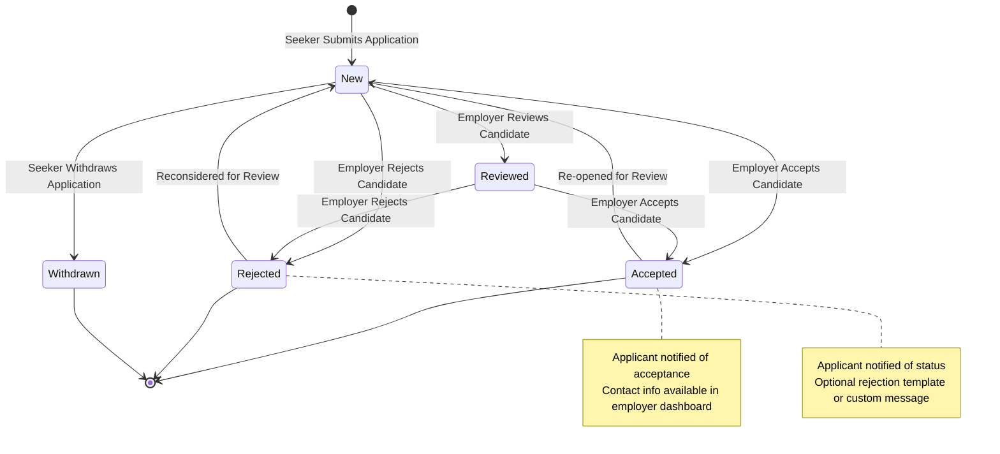

# 12 - Notifications and Applications

## 1. Transactional Coupling Architecture

In the **Batanes Niche Job Portal**, the job application lifecycle and the notification engine are coupled within **Explicit Database Transaction Boundaries**.

When a user submits an application or an employer modifies an applicant's status, the state change and the recipient notification are inserted or updated **atomically** in the same transaction. If notification generation fails, the entire transaction is rolled back, preventing orphaned state changes or silent omissions.

```
+-----------------------------------------------------------------------------------+
|                           EXPLICIT TRANSACTION BOUNDARY                           |
|                                                                                   |
|   1. Verify preconditions (Role, Job Active, Non-duplicate, Allowed transition)   |
|   2. Execute application table mutation (INSERT or UPDATE)                        |
|   3. Insert corresponding notification record into notifications table            |
|   4. Commit transaction (or Rollback on any failure)                              |
+-----------------------------------------------------------------------------------+
```

---

## 2. Application Submission Workflow

Job application submission is implemented in `ApplicationService.submit_application`:

### Precondition Checks
1. **Role Check**: Verifies `current_user.role == 'job_seeker'`. Employers and guests are rejected with `HTTP 403 Forbidden`.
2. **Job Status Check**: Verifies target job exists, has `status == 'active'`, and `deleted_at IS NULL`. Closed or deleted jobs are rejected with `HTTP 400 Bad Request`.
3. **Self-Application Check**: Verifies `job.employer_id != seeker.id`. Users cannot apply to their own job listings (`HTTP 400 Bad Request`).
4. **Duplicate Application Prevention**: Verifies via `ApplicationRepository.hasActiveApplication(job_id, seeker_id)` and the database partial unique index `uq_active_applications` on `(job_id, seeker_id) WHERE status NOT IN ('withdrawn', 'rejected')`. Duplicate active attempts are rejected with `HTTP 409 Conflict: You already have an active application for this job.`, while allowing reapplications after withdrawal or rejection with full history preserved.

### Transaction Boundary Execution
```typescript
// Implemented via Prisma $transaction in applicationService.ts
return await prisma.$transaction(async (tx) => {
  // 1. Insert application record
  const application = await tx.application.create({
    data: {
      job_id: job.id,
      seeker_id: seeker.id,
      cover_letter: appData.cover_letter?.trim() || null,
      resume_url: appData.resume_url?.trim() || seeker.resume_url,
      answers: appData.answers ? JSON.stringify(appData.answers) : null,
      status: "new",
      stage: "new",
    },
  });

  // 2. Insert employer notification
  await tx.notification.create({
    data: {
      user_id: job.employer_id,
      title: "New Application Received",
      message: `${seeker.full_name} submitted an application for your job posting: '${job.title}'.`,
      type: "new_application",
      link: "/employer",
    },
  });

  return application;
});
```

---

## 3. Application Status State Machine & Transitions

Employers manage applicant progress through a validated state machine and recruitment pipeline (`applicationService.ts`):



### Transition Enforcement Rules
- Allowed transitions from `new`: `reviewed`, `accepted`, `rejected`, `withdrawn`.
- Allowed transitions from `reviewed`: `accepted`, `rejected`, `withdrawn`.
- Allowed transitions from `accepted`: `new`.
- Allowed transitions from `rejected`: `new`.

### Extended Pipeline & Interview Scheduling
The application domain supports full recruitment lifecycle management:
- **Interview Invitations**: Employers can schedule interviews with `interview_date`, `interview_type` (in-person, video, phone), `interview_location`, and `interview_message`. The applicant responds with `interview_status` (`accepted` or `declined`).
- **Rejection Messaging**: Employers can choose a predefined `rejection_template` or write a custom `rejection_message`.
- **Application Withdrawal**: Job seekers can withdraw an application at any point prior to finalization (`withdrawn_at` timestamp).

### Transaction Boundary on Status Update
```typescript
// Implemented via Prisma $transaction in applicationService.ts
return await prisma.$transaction(async (tx) => {
  const updatedApp = await tx.application.update({
    where: { id: applicationId },
    data: { status: newStatus, stage: newStage || undefined },
  });

  // Atomic Notification for Applicant
  const statusText = newStatus === "accepted" ? "accepted" : (newStatus === "rejected" ? "rejected" : "updated");
  await tx.notification.create({
    data: {
      user_id: application.seeker_id,
      title: "Application Status Updated",
      message: `Your application for '${application.job.title}' was ${statusText}.`,
      type: "application_status_updated",
      link: "/dashboard",
    },
  });

  return updatedApp;
});
```

---

## 4. Applicant Contact Revelation Rules

To balance candidate privacy with hiring utility:
1. **Public Search Masking**: In the public candidate directory (`/api/v1/users/job-seekers`), seeker emails and phone numbers are strictly withheld.
2. **Authorized Revelation**: When an employer lists received applications (`GET /api/v1/applications`), `ApplicationService._to_employer_application_out` verifies that the current user owns the associated job. If verified, the system materializes the full `EmployerApplicantProfile`:
   - `email`: Direct candidate email address.
   - `phone_number`: Candidate telephone/mobile number.
   - `resume_url`: Candidate resume PDF URL.
   - Complete vocational background (skills, experience years, education, bio).

---

## 5. In-App Notification System

In-app notifications provide non-intrusive, persistent communication between applicants and employers.

### Notification Entity Schema
- `id`: Primary key.
- `user_id`: Foreign key referencing the receiving user.
- `title`: Concise notification header (e.g., *"New Application Received"*).
- `message`: Contextual description including job title and counterparty name.
- `type`: Taxonomy code (`new_application`, `application_status_updated`).
- `link`: Client-side SPA route for direct navigation (`/employer` or `/dashboard`).
- `is_read`: Boolean flag (default `False`).
- `created_at`: Timestamp.

### Read Management
- **Retrieve Feed**: `GET /api/v1/notifications?limit=50&offset=0` returns notifications sorted by `created_at DESC`.
- **Acknowledge All**: `POST /api/v1/notifications/read` bulk-updates all unread notifications for the authenticated user (`UPDATE notifications SET is_read = True WHERE user_id = :id AND is_read = False`).

---

## 6. Communication Scope Boundaries (Version 2)

Version 2 explicitly intentionally omits real-time instant messaging and chat:
- **No Direct Chat**: Communication occurs via the application status state machine and persistent notifications.
- **Direct Offline Contact**: Once an application is submitted, employers are authorized to contact applicants directly via standard telephone or email using the authorized contact details.

---

## 7. Next Steps

- For canonical geography rules and distance calculations, see [**13-Geography-and-Reference-Data.md**](./13-Geography-and-Reference-Data.md).
- To inspect unit tests for applications and duplicate checks, see [**14-Testing-and-Quality.md**](./14-Testing-and-Quality.md).
- For local seeding procedures, see [**17-Developer-Guide.md**](./17-Developer-Guide.md).
