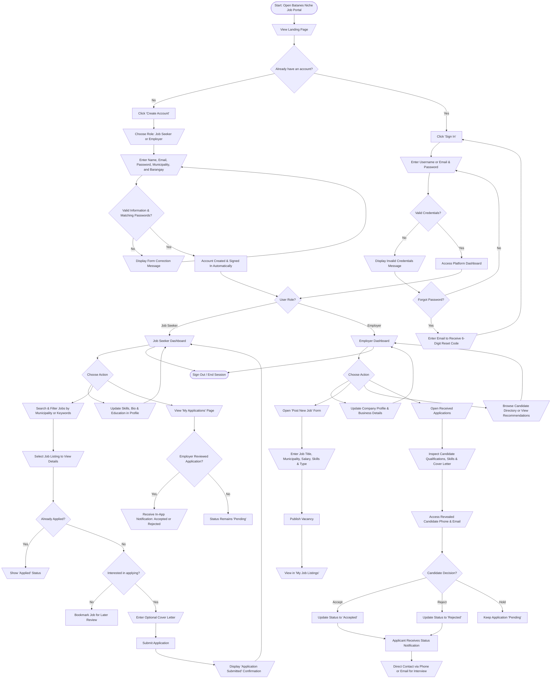
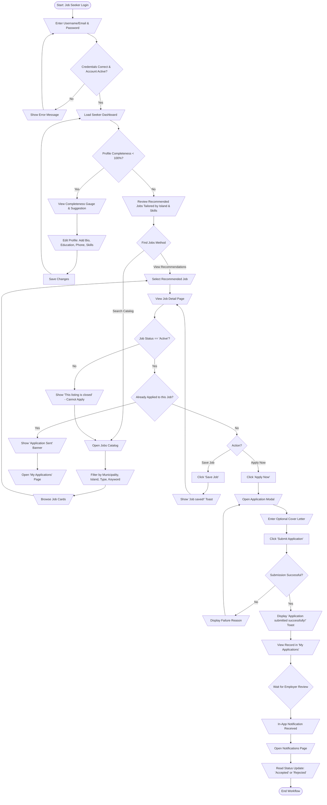
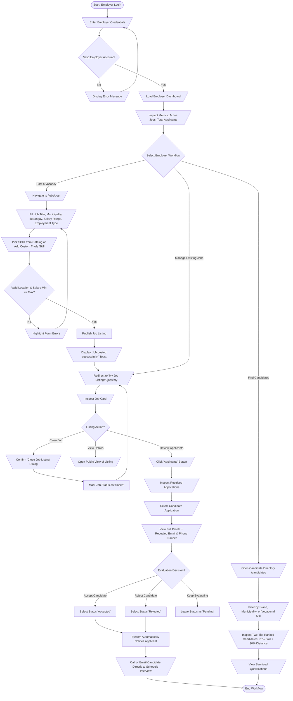
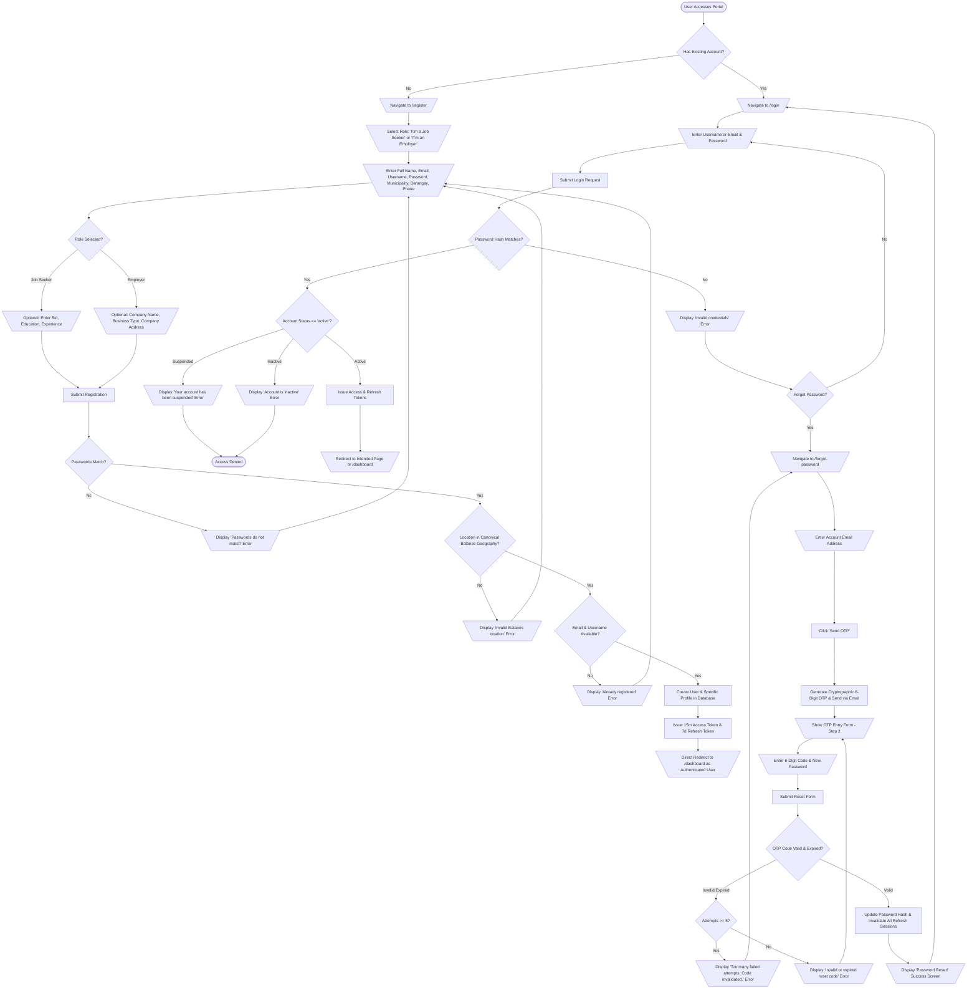
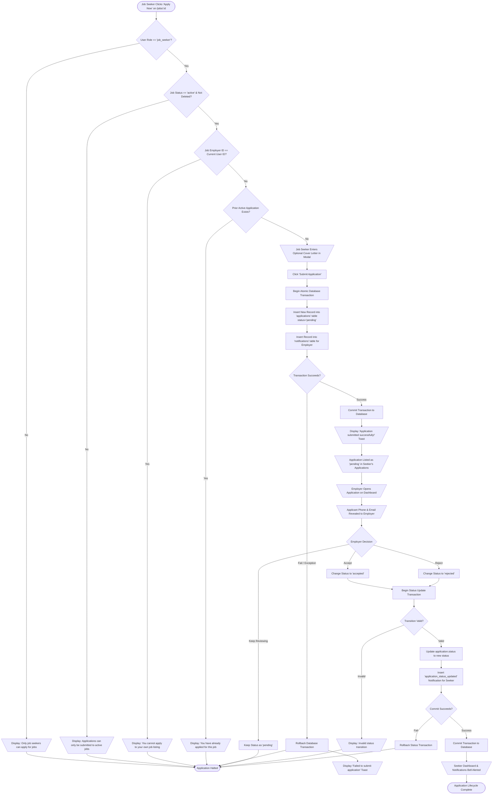
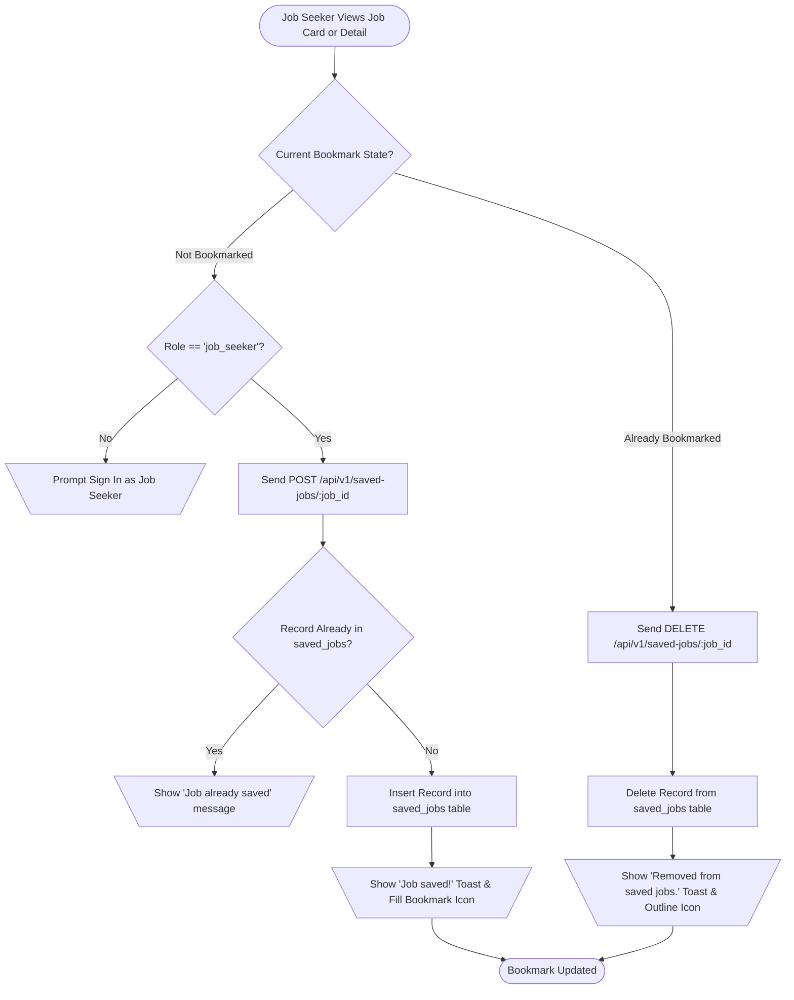
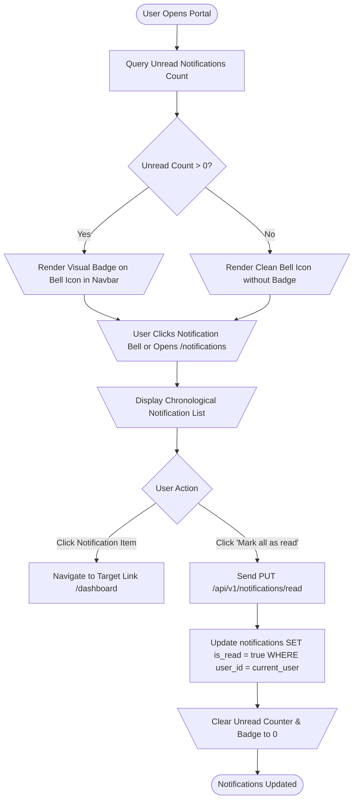
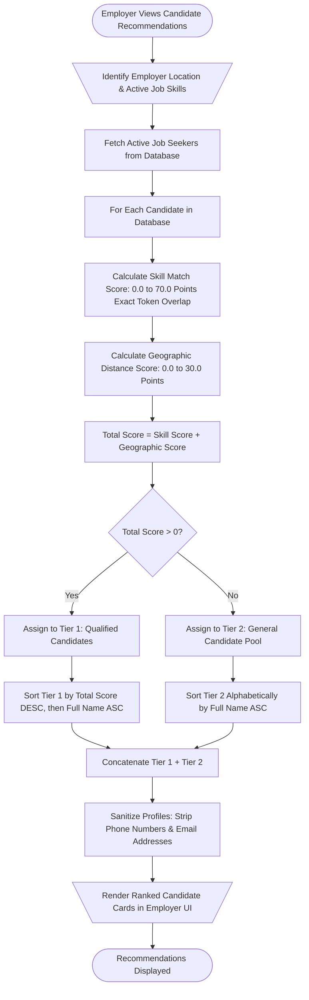
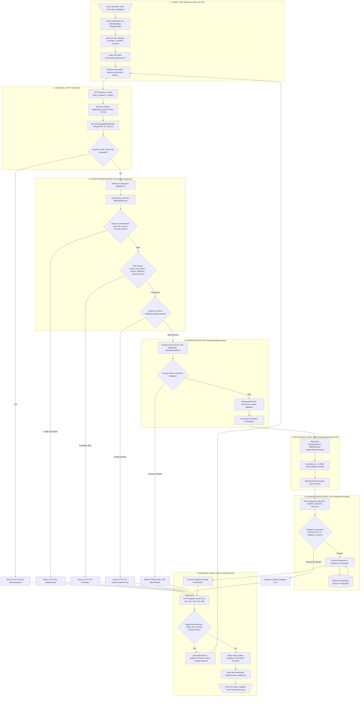

# 20 - System Flowcharts

## 1. Overview & Visual Conventions

This document provides visual flowcharts modeling the operational journeys and multi-layer technical execution paths of the **Batanes Niche Job Portal (Version 2)**.

To serve both non-technical stakeholders (evaluators, municipal partners, administrators) and software engineers, these flowcharts are divided into three distinct levels:
1. **Level 1 — General User Journey Flowchart**: A non-technical, high-level perspective mapping how users interact with the system without exposing backend internals.
2. **Level 2 — Specific User Workflows**: Dedicated role-based and task-focused journeys for Job Seekers, Employers, Authentication/Password Reset, Job Applications, Bookmarks, Notifications, Candidate Recommendations, and Administrative Moderation.
3. **Level 3 — Complete Multi-Tier System Flow**: An end-to-end technical execution pipeline tracing user interactions through the React SPA, Axios client, FastAPI routers, authentication dependencies, domain services, repositories, SQLAlchemy ORM, and the database.

### Standard Flowchart Conventions

All flowcharts adhere to standard flowchart symbology:

| Shape Name | Mermaid Syntax | Visual Representation | Standard Purpose |
|---|---|---|---|
| **Terminator** | `([Text])` | Rounded rectangle / oval | Indicates the Start or End point of a workflow. |
| **Process** | `[Text]` | Rectangle | Represents an action, system task, or state computation. |
| **Decision** | `{Text?}` | Diamond | Represents a conditional check branching the flow based on a boolean or choice. |
| **Input / Output** | `[\Text/]` | Parallelogram | Denotes user data entry (forms) or user-facing display (pages, dialogs, banners). |
| **Connector** | `-->` | Directed line with arrowhead | Establishes the direction of flow and sequence of execution. |

---

## 2. Flowchart 1: General User Journey Flowchart

> [!NOTE]
> This flowchart is designed for non-technical audiences, presentations, and product demonstrations. It focuses purely on user actions, decisions, and outcomes without technical jargon, SQL queries, or HTTP status codes.



---

## 3. Flowchart 2: Specific User Workflows

### 3.1 Job Seeker Workflow

This diagram models the entire lifecycle of an Ivatan job seeker from account access to job hunting, application tracking, and profile optimization.



---

### 3.2 Employer Workflow

This diagram models the enterprise employer journey: maintaining company presence, posting localized vacancies, reviewing matched applicants, and managing candidate progression.



---

### 3.3 Authentication & Account Access Workflow

This flowchart traces user entry, registration validation, credential authentication, and the 6-digit email OTP password recovery pipeline.



---

### 3.4 Job Application Workflow

This diagram models the precise operational rules, precondition gates, atomic transaction boundaries, and state transitions of a job application.



---

### 3.5 Supporting Workflows

#### 3.5.1 Saved Jobs (Bookmarks) Workflow


#### 3.5.2 In-App Notifications Workflow


#### 3.5.3 Candidate Recommendation & Two-Tier Ranking Workflow


#### 3.5.4 Administrative User Moderation & Oversight Workflow
```mermaid
flowchart TD
    StartAdmin([Administrator Opens /admin]) --> CheckAdminCookie{Valid 'batanes_admin_session' Cookie?}
    CheckAdminCookie -- No --> ShowAdminLogin[\Display Server-Rendered Jinja2 Login Form/]
    ShowAdminLogin --> EnterAdminCreds[\Enter Admin Username & Password/]
    EnterAdminCreds --> VerifyAdmin[Verify Role == 'admin' & Password Hash]
    VerifyAdmin -- Invalid --> AdminLoginErr[\Display 'Invalid administrator credentials' Banner/]
    AdminLoginErr --> ShowAdminLogin
    VerifyAdmin -- Valid --> SetAdminCookies[Set HttpOnly Session Cookie & CSRF Cookie]
    SetAdminCookies --> AdminDashboard[\Render Server-Side Admin Dashboard /admin/dashboard/]

    CheckAdminCookie -- Yes --> AdminDashboard
    AdminDashboard --> ChooseAdminTool{Choose Admin Module}

    %% User Moderation
    ChooseAdminTool -- User Moderation --> OpenUsersList[\Open /admin/users/]
    OpenUsersList --> SearchUsers[\Filter by Search Keyword, Role, or Account Status/]
    SearchUsers --> UserActionChoice{Select User Action}
    
    UserActionChoice -- Suspend Account --> PostSuspend[POST /admin/users/:id/suspend with CSRF Token]
    PostSuspend --> SetSuspended[UPDATE users SET account_status = 'suspended']
    SetSuspended --> InvalidateUserSessions[Revoke All Active Refresh Tokens for User]
    InvalidateUserSessions --> AuditSuspend[Append Record to audit_logs: USER_SUSPEND]
    AuditSuspend --> RedirectUsers[\Redirect to /admin/users with Success Notice/]

    UserActionChoice -- Restore Account --> PostRestore[POST /admin/users/:id/restore with CSRF Token]
    PostRestore --> SetActive[UPDATE users SET account_status = 'active']
    SetActive --> AuditRestore[Append Record to audit_logs: USER_RESTORE]
    AuditRestore --> RedirectUsers

    %% Job Moderation
    ChooseAdminTool -- Job Moderation --> OpenJobsList[\Open /admin/jobs/]
    OpenJobsList --> FilterJobs[\Filter Listings by Status/]
    FilterJobs --> JobActionChoice{Job Action?}
    JobActionChoice -- Disable Job --> PostDisableJob[POST /admin/jobs/:id/disable with CSRF Token]
    PostDisableJob --> SetJobClosed[UPDATE jobs SET status = 'closed', deleted_at = now()]
    SetJobClosed --> AuditJobDisable[Append Record to audit_logs: JOB_DISABLED]
    AuditJobDisable --> RedirectJobs[\Redirect to /admin/jobs with Notice/]

    %% Audit Logs & Error Reports
    ChooseAdminTool -- Review Audit Logs --> OpenAuditLogs[\Open /admin/audit-logs: Inspect Actor, Action, IP, Timestamps/]
    ChooseAdminTool -- Inspect Errors --> OpenErrorReports[\Open /admin/error-reports: Inspect Scrubbed 500 Stack Traces/]

    RedirectUsers --> AdminDashboard
    RedirectJobs --> AdminDashboard
    OpenAuditLogs --> AdminDashboard
    OpenErrorReports --> AdminDashboard
    AdminDashboard --> AdminSignOut([Sign Out: Clear Session Cookie])
```

---

## 4. Flowchart 3: Complete Multi-Tier System Flow

> [!NOTE]
> This comprehensive flowchart models the end-to-end technical architecture. It demonstrates how user gestures propagate through the frontend SPA, cross the network boundary via Axios, trigger FastAPI route controllers and dependency guards, invoke domain services and repositories, execute SQL transactions, and return structured JSON responses that update reactive frontend state.



---

## 5. Next Steps & Cross-References

- To look up the exact files, components, and services to edit for any specific feature, consult [**21-Developer-Architecture-Guide.md**](./21-Developer-Architecture-Guide.md).
- To examine low-level database table definitions, foreign keys, and ERD structures, see [**04-Database-and-ERD.md**](./04-Database-and-ERD.md).
- To inspect REST API endpoints and JSON contract schemas, see [**05-API-Architecture.md**](./05-API-Architecture.md).
- For complete coverage of the recommendation algorithm mathematical formulas, see [**09-Recommendation-Engine.md**](./09-Recommendation-Engine.md).
- For operational runbooks and testing instructions, see [**17-Developer-Guide.md**](./17-Developer-Guide.md).
